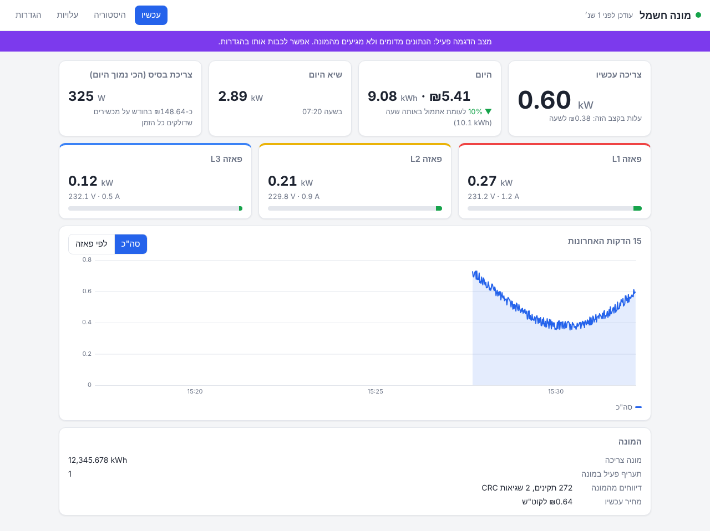
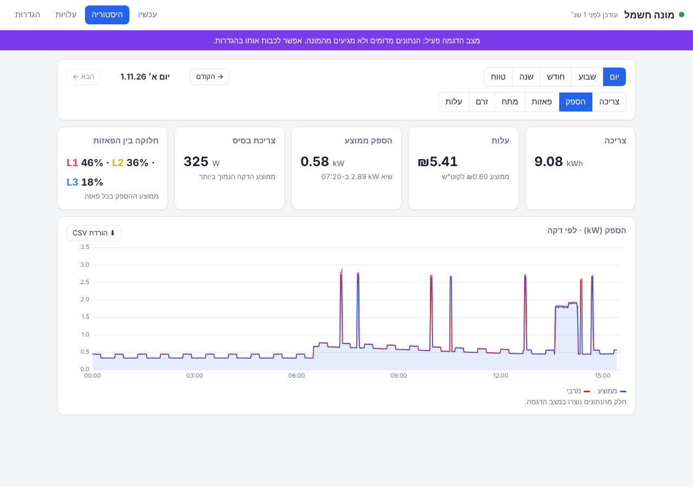
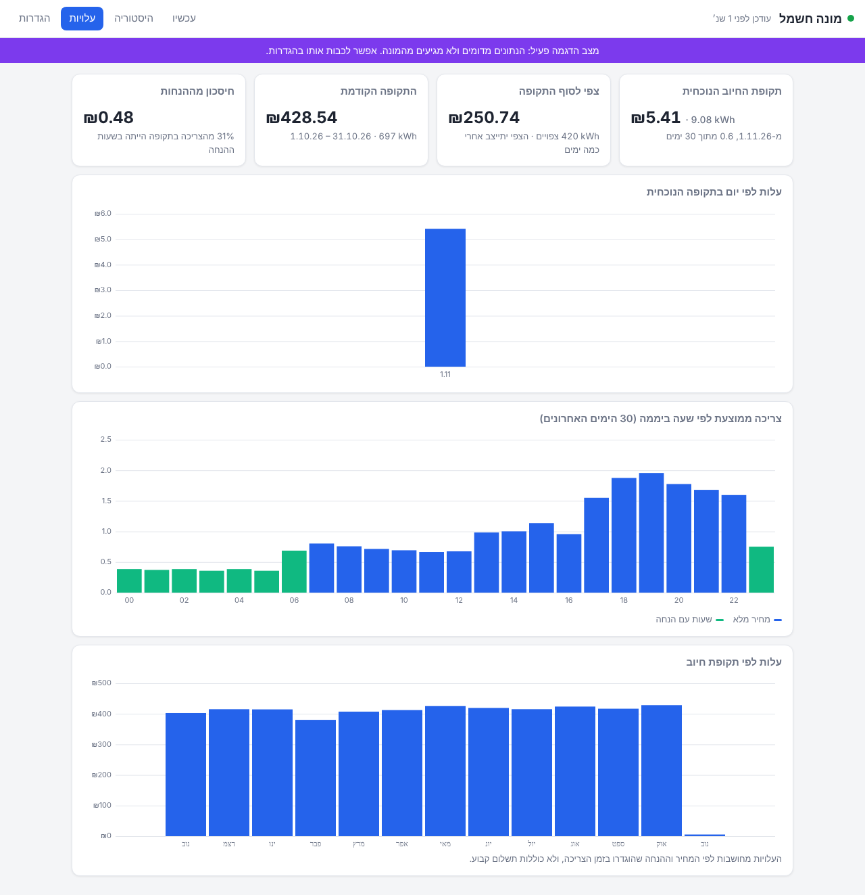
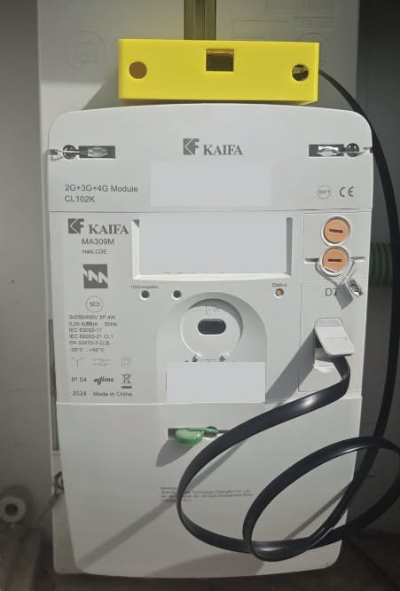
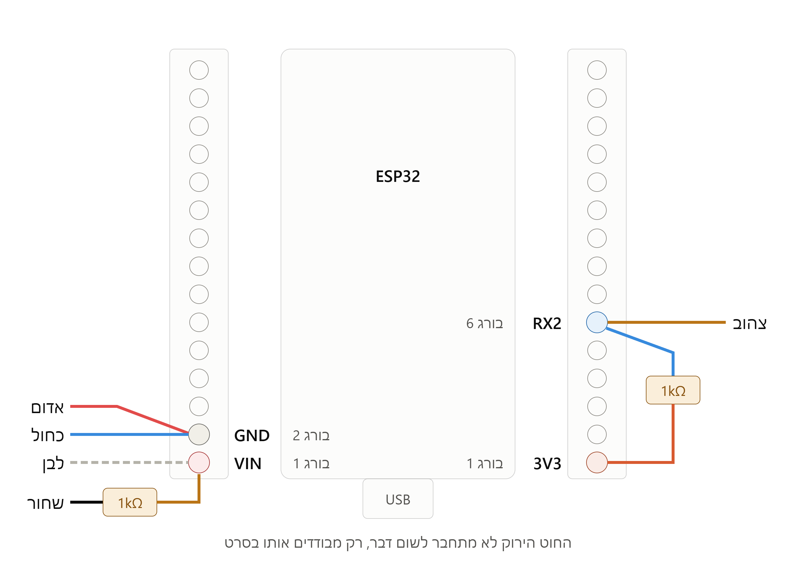

# ⚡ קורא מונה חכם עם ESP32

מכשיר קטן שמתחבר לשקע ה-P1 במונה החכם של חברת החשמל, ומציג בדפדפן את צריכת החשמל של הבית.

המכשיר עובד לבד: הוא מתחבר ל-Wi-Fi של הבית ושומר את ההיסטוריה בזיכרון שלו. אין צורך בשרת, באפליקציה או בשירות ענן. הוא מתאים למוני Kaifa של חברת החשמל, תלת-פאזי (MA309M) או חד-פאזי (MA110M).

<p align="center"></p>

## מה רואים בממשק

הממשק בעברית, ונכנסים אליו עם שם משתמש וסיסמה.

* **עכשיו:** הספק, מתח וזרם בכל פאזה, גרף של 15 הדקות האחרונות, והצריכה והעלות של היום.
* **היסטוריה:** גרפים לפי יום, שבוע, חודש או שנה, והורדה של הנתונים לאקסל.
* **עלויות:** כמה עלתה התקופה עד עכשיו, צפי לסוף החודש, וכמה חסכת במסלול ההנחה.
* **הגדרות:** מחיר לקוט"ש, הנחות לפי שעות, רשת Wi-Fi, סיסמה ועדכון קושחה.

<p align="center">
  
  
</p>

## מה צריך

| רכיב | פרטים |
|---|---|
| לוח ESP32 | 30 פינים, עם המודול ESP32-WROOM-32D, חיבור USB-C ושבב USB מסוג CH340 |
| לוח מהדקים | לוח הרחבה עם מהדקי בורג ל-ESP32. לא חובה, אבל חוסך הלחמות |
| כבל RJ12 | מסוג 6P6C: שישה מגעים ושישה גידים. כבל טלפון רגיל או כבל רשת לא מתאימים |
| 2 נגדים | 1kΩ |
| קופסה | לא חובה. יש [קובץ להדפסה בתלת-ממד](https://makerworld.com/en/models/3523403-breakout-board-for-esp#profileId-4027704) |

בנוסף: מולטימטר, וכבל USB-C שמעביר נתונים. המכשיר מקבל חשמל מהמונה עצמו, ולכן אין צורך בספק כוח.

<p align="center">
  
  
</p>

## איך מתחילים

1. **צריבה:** מעבירים את הקושחה ללוח, ישר מהדפדפן ובלי להתקין כלום. עובד ב-Windows, ב-macOS וב-Linux.
2. **הגדרה:** מתחברים לרשת `HElectricity` ובוחרים את רשת הבית.
3. **בדיקה:** בודקים את המערכת במצב הדגמה, עוד בלי מונה.
4. **חיבור:** מחווטים, מודדים מתח ומחברים למונה.

**📘 [המדריך המלא, שלב אחר שלב](docs/GUIDE.md)**

## חשוב לדעת

* **גישה מבחוץ:** הממשק מיועד לרשת הביתית, ועובד בלי הצפנה. כדי להיכנס אליו מחוץ לבית, השתמש ב-VPN. אל תפתח אליו פורט בנתב.
* **עלויות:** העלות מחושבת לפי המחיר וההנחות שהגדרת. תקופת החיוב היא חודשית, כך שחשבון דו-חודשי יוצג כשתי תקופות.
* **מונים אחרים:** הקושחה מותאמת למוני Kaifa של חברת החשמל. במונים אחרים ייתכן שהיא לא תזהה את כל הנתונים.
* **סטטוס:** הקוד נבדק בסימולציה, בבדיקות אוטומטיות ובדפדפן. הוא עדיין לא נבדק על לוח ומונה אמיתיים.

<details>
<summary><b>פרטים טכניים ופיתוח</b></summary>

### איך זה עובד

```
P1 (115200, הפוך) ──> מפענח עם בדיקת CRC ──> מאגר חי ב-RAM (15 דק׳)     ──> /api/live, /api/recent
                                           └─> צבירה לדקה ──> שעה ──> יום ──> LittleFS ──> /api/history, CSV
```

* **קריאה:** כל דיווח מהמונה נבדק עם CRC16. דיווח פגום נזרק.
* **אנרגיה:** הצריכה מחושבת מההפרש במוני המונה, ונשמרת כמספר שלם ב-Wh. לכן גם הפעלה מחדש לא מאבדת צריכה.
* **שעון:** מהאינטרנט (NTP). אם אין אינטרנט, מהשעון של המונה. לפי אזור הזמן של ישראל, כולל שעון קיץ.
* **עלות:** נשמרת עם כל רשומה, לפי המחיר שחל בזמן הצריכה.
* **אבטחה:** הסיסמה שמורה כ-hash עם salt. הכניסה ננעלת לדקה אחרי 5 ניסיונות כושלים. יש הגנת CSRF.
* **רשת גיבוי:** אם רשת הבית נופלת ליותר מ-3 דקות, נפתחת הרשת `HElectricity` כגיבוי.

### משאבים (ESP32 עם 4MB פלאש)

| משאב | בשימוש | זמין |
|---|---|---|
| קושחה, כולל הממשק | 920KB | 1,280KB |
| זיכרון RAM קבוע | 85KB | 320KB |
| היסטוריה | עד 1.0MB | 1,408KB |

| רמת היסטוריה | נשמרת |
|---|---|
| כל דקה | כ-5 ימים |
| כל שעה | כ-13 חודשים |
| כל יום | כ-5 שנים |

הכתיבה לפלאש נעשית במנות, כך שהפלאש יחזיק עשרות שנים. את זמני השמירה אפשר לשנות ב-[`firmware/src/config.h`](firmware/src/config.h).

### מבנה הפרויקט

```
firmware/
  platformio.ini        הגדרות בנייה
  src/                  הקוד. ההגדרות הקבועות ב-config.h
  web/index.html        הממשק (מוטמע אוטומטית בקושחה)
  test/host/            בדיקות יחידה וסימולציה של 400 יום
  tools/                הטמעת הממשק, ושרת דמה לפיתוח הממשק
docs/                   המדריך והתמונות
release/                קבצים מוכנים לצריבה
```

### בדיקות

הבדיקות רצות על המחשב, בלי ESP32. ב-macOS וב-Linux, או ב-Windows דרך WSL:

```bash
make -C firmware/test/host            # 108 בדיקות יחידה
make -C firmware/test/host sim-data   # סימולציה של 400 ימים
python3 firmware/tools/mock_server.py # הממשק עם נתוני דמה: http://localhost:8080, admin / password123
```

</details>

## קרדיט ורישיון

תכנון החומרה מבוסס על שני פרויקטים קודמים, שניהם ברישיון MIT:

* הפרויקט [klimofey/iec-p1-esphome](https://github.com/klimofey/iec-p1-esphome) של Timofey Klimov, הראשון, למונה חד-פאזי. ממנו הגישה לקריאת שקע ה-P1 במוני Kaifa של חברת החשמל, קודי ה-OBIS הישראליים (`1.8.11` עד `1.8.13`), והדיווח לדוגמה שמשמש בבדיקות.
* הפרויקט [mp3llll/iec-p1-esphome-3phase](https://github.com/mp3llll/iec-p1-esphome-3phase), שמבוסס על הפרויקט הראשון ומרחיב אותו למונה תלת-פאזי ול-ESP32. ממנו החיווט, רשימת הרכיבים, תמונות החומרה ותרשים החיווט.

הקוד בפרויקט הזה נכתב מחדש. הפרויקט מופץ ברישיון MIT. ראה [`LICENSE`](LICENSE).

**לשימוש על אחריותך בלבד.** אין קשר לחברת החשמל או ל-Kaifa.
