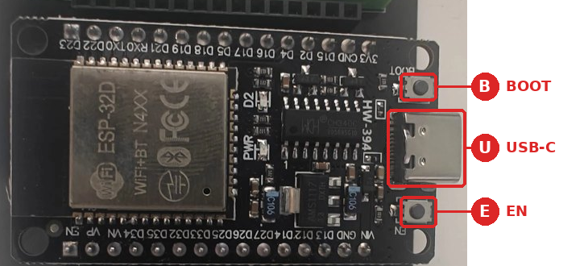
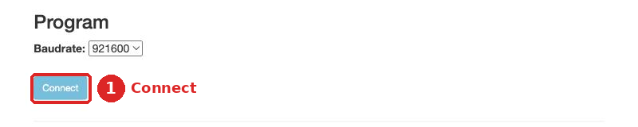
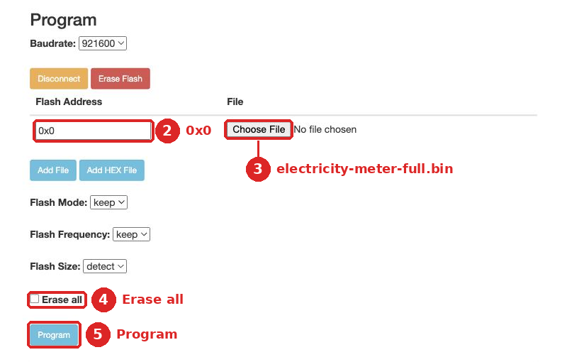
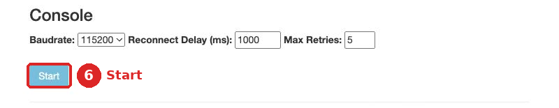

# מדריך צריבה

איך מעבירים את הקושחה ל-ESP32. מתאים ל-Windows, ל-macOS ול-Linux.

בזמן הצריבה הלוח מחובר **רק למחשב**, בכבל USB. **לא למונה.**

| | [דרך א׳: מהדפדפן](#2-דרך-א-צריבה-מהדפדפן) (מומלץ) | [דרך ב׳: PlatformIO](#3-דרך-ב-צריבה-עם-platformio) |
|---|---|---|
| מה מתקינים | כלום. צריך Chrome או Edge | התוסף PlatformIO ל-VS Code |
| רשת הבית | בוחרים אחרי הצריבה, דרך הרשת `HElectricity` | אפשר לקבוע מראש בקובץ `secrets.h` |

---

## 1. חיבור הלוח למחשב

<p align="center"></p>

בתמונה: **U** הוא חיבור ה-USB-C. **B** הוא כפתור BOOT, שנחוץ רק אם הצריבה נתקעת. **E** הוא כפתור EN, שמפעיל את הלוח מחדש.

חבר את הלוח בכבל USB-C שמעביר נתונים, ולא רק טעינה. שבב ה-USB בלוח הוא CH340C. בדוק שהמחשב מזהה אותו, לפי מערכת ההפעלה שלך:

<details>
<summary><b>Windows</b></summary>

1. פתח את **מנהל ההתקנים** (Device Manager): קליק ימני על כפתור התחל.
2. תחת **יציאות (COM ו-LPT)** אמורה להופיע השורה `USB-SERIAL CH340 (COM3)`. המספר משתנה. זה שם היציאה של הלוח.
3. אם הלוח לא מופיע שם, או מופיע עם סימן קריאה צהוב, התקן את הדרייבר הרשמי של יצרן השבב, [CH341SER.EXE](https://www.wch-ic.com/downloads/CH341SER_EXE.html). אחר כך נתק את הלוח וחבר אותו שוב.

</details>

<details>
<summary><b>macOS</b></summary>

הדרייבר מובנה במערכת, מגרסה 10.14 ואילך. ב-Terminal:

```bash
ls /dev/cu.*
```

אמורה להופיע שורה בסגנון `/dev/cu.usbserial-1420`. המספר משתנה. זה שם היציאה של הלוח.

</details>

<details>
<summary><b>Linux</b></summary>

הדרייבר מובנה בליבה. בטרמינל:

```bash
ls /dev/ttyUSB*
```

אמורה להופיע `/dev/ttyUSB0`. זה שם היציאה של הלוח.

פעם אחת, תן למשתמש שלך הרשאה להשתמש ביציאה, ואז התנתק מהמערכת והתחבר מחדש:

```bash
sudo usermod -aG dialout $USER     # ב-Arch: uucp במקום dialout
```

ב-Ubuntu 22.04 ואילך, אם היציאה מופיעה ונעלמת אחרי שנייה, החבילה brltty תופסת אותה. הסר אותה:

```bash
sudo apt remove brltty
```

</details>

היציאה לא מופיעה? כמעט תמיד הבעיה בכבל. נסה כבל אחר, וחבר ישירות למחשב ולא דרך מפצל.

---

## 2. דרך א׳: צריבה מהדפדפן

עובד בכל מערכת, ב-Chrome או ב-Edge. ב-Safari וב-Firefox לא.

1. הורד את קובץ הקושחה [`electricity-meter-full.bin`](https://github.com/yoni03/iec-PlatformIO-3phase/raw/main/release/electricity-meter-full.bin).
2. פתח את [ESP Tool](https://espressif.github.io/esptool-js/), הכלי הרשמי של Espressif, יצרנית השבב. **אל תסמן** בו את התיבה **WebUSB (CH340)**.
3. לחץ **Connect** ①, בחר את היציאה מסעיף 1 ולחץ **Connect** בחלון שנפתח. אחרי כמה שניות יופיעו פרטי השבב בחלון השחור.

   

4. מלא את אפשרויות הצריבה:
   * ② בשדה **Flash Address**, מחק את מה שכתוב וכתוב במקומו `0x0`. זה הצעד החשוב: בכתובת אחרת הצריבה תסתיים בלי שגיאה, אבל הלוח לא יעלה.
   * ③ לחץ **Choose File** ובחר את הקובץ שהורדת.
   * ④ סמן **Erase all**.
   * ⑤ לחץ **Program**. הצריבה לוקחת דקה עד שתיים. אל תנתק את הלוח עד שההתקדמות מגיעה ל-100%.

   

5. לחץ על כפתור **EN** בלוח. הלוח עולה עם הקושחה החדשה.

**לבדיקת הלוג (לא חובה):** לחץ **Disconnect**, ואז **Start** ⑥ באזור **Console**. בחר שוב את היציאה ולחץ **EN** בלוח. מה אמור להופיע, ראה [סעיף 4](#4-איך-יודעים-שהצריבה-הצליחה).



---

## 3. דרך ב׳: צריבה עם PlatformIO

1. התקן את [VS Code](https://code.visualstudio.com/). בתוכו, פתח את חלון התוספים (**View > Extensions**), חפש **PlatformIO IDE** ולחץ **Install**. כשההתקנה מסתיימת, לחץ **Reload Now**.

   <details>
   <summary>דרישות נוספות לפי מערכת ההפעלה</summary>

   * ב-**Windows** אין צורך בדבר. התוסף מתקין בעצמו את מה שחסר.
   * ב-**macOS**, אם המערכת מבקשת להתקין את **Command Line Developer Tools**, אשר.
   * ב-**Linux**, פעם אחת, בטרמינל:

     ```bash
     sudo apt install python3-venv        # Debian / Ubuntu
     curl -fsSL https://raw.githubusercontent.com/platformio/platformio-core/develop/platformio/assets/system/99-platformio-udev.rules | sudo tee /etc/udev/rules.d/99-platformio-udev.rules
     sudo udevadm control --reload-rules && sudo udevadm trigger
     ```

   </details>

2. הורד את הקוד: בדף [הריפו](https://github.com/yoni03/iec-PlatformIO-3phase) לחץ **Code > Download ZIP** וחלץ את הקובץ. אפשר גם `git clone`.
3. ב-VS Code: **File > Open Folder** (או **Pick a folder** בחלון של PlatformIO), ובחר את התיקייה **`firmware`** שבתוך הפרויקט. לא את התיקייה הראשית: PlatformIO מזהה את הפרויקט לפי הקובץ `platformio.ini`, שנמצא ב-`firmware`. אחרי הפתיחה, בראש החלון יופיע `firmware`, ובשורת המצב למטה יופיעו כפתורי PlatformIO.
4. **לא חובה, קביעת רשת הבית מראש:** העתק את `src/secrets.example.h` לקובץ חדש בשם `src/secrets.h`, ומלא בו את שם הרשת והסיסמה. אפשר למלא גם שם משתמש וסיסמה לממשק. ההוראות כתובות בתוך הקובץ. הקובץ לא עולה ל-GitHub, אבל הפרטים נכנסים לקושחה שנבנית, ולכן אל תשתף אותה.
5. לחץ **Upload** (→) בשורת המצב בתחתית החלון. בפעם הראשונה PlatformIO מוריד כלים, וזה לוקח כמה דקות. בסוף יופיע `[SUCCESS]`.
6. לחץ **Serial Monitor** (🔌) ואז **EN** בלוח, כדי לראות את הלוג. סגור את חלון הלוג לפני צריבה נוספת.

---

## 4. איך יודעים שהצריבה הצליחה

הלוג אמור להיראות בערך כך:

```
Electricity meter 1.0.0
[fs] … / 1441792 bytes used
[wifi] not configured: starting the setup access point
[wifi] access point 'HElectricity' on, http://192.168.4.1
[web] server on port 80
```

אחרי כמה שניות תופיע רשת Wi-Fi בשם **`HElectricity`**.

אם קבעת את רשת הבית ב-`secrets.h`, הלוח יתחבר אליה ישירות, ובמקום השורות על הרשת `HElectricity` תופיע שורה כזו:

```
[wifi] connected, IP 192.168.1.57, RSSI -58
```

ממשיכים ל[הגדרה ראשונית, בסעיף 3 במדריך](GUIDE.md#3-הגדרה-ראשונית).

---

## 5. תקלות בצריבה

| תקלה | מה לעשות |
|---|---|
| החיבור נתקע ב-`Connecting...` | החזק את **BOOT**, לחץ שוב **Connect** (או **Upload**), ושחרר כשהכתיבה מתחילה |
| הצריבה נכשלת באמצע | שנה את **Baudrate** ל-`115200` ונסה שוב. ב-Linux זה נפוץ במיוחד |
| הודעת שגיאה כמו `port is busy`, `Access denied` או `Permission denied` | סגור תוכנה אחרת שמשתמשת ביציאה, כמו חלון לוג פתוח. ב-Linux, בדוק את ההרשאה בסעיף 1 |
| הצריבה הסתיימה אבל הלוח לא עולה, והלוג מראה `invalid header` | הקובץ נכתב לכתובת שגויה. צרוב שוב עם **Flash Address** `0x0` ועם **Erase all** |
| חלון בחירת היציאה ריק | בדוק לפי סעיף 1. ב-Ubuntu, השתמש ב-Google Chrome ולא ב-Chromium שמותקן מ-Snap |
| ב-PlatformIO אין כפתורי Build ו-Upload | נפתחה התיקייה הראשית. פתח את `firmware` |
| ב-VS Code מופיעה השגיאה `#include errors detected` | זו שגיאה של השלמת הקוד ולא של הבנייה. היא נעלמת אחרי ש-PlatformIO מסיים להכין את הפרויקט. ודא שפתחת את `firmware`, חכה שההורדות בפינה הימנית התחתונה יסתיימו, ולחץ **Build** (✓) פעם אחת |
