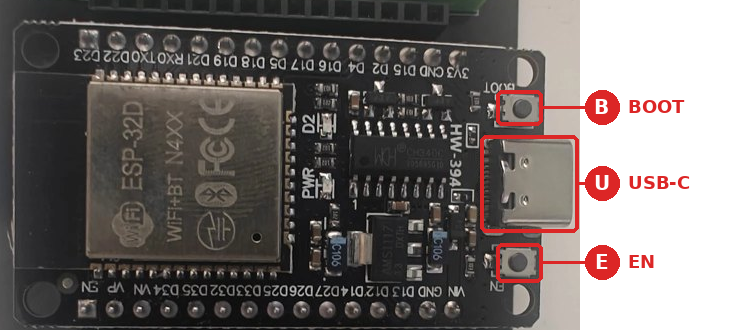
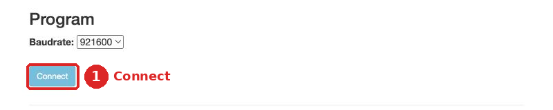
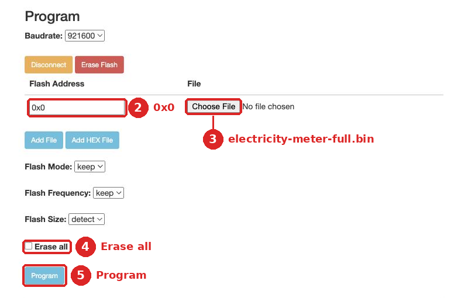
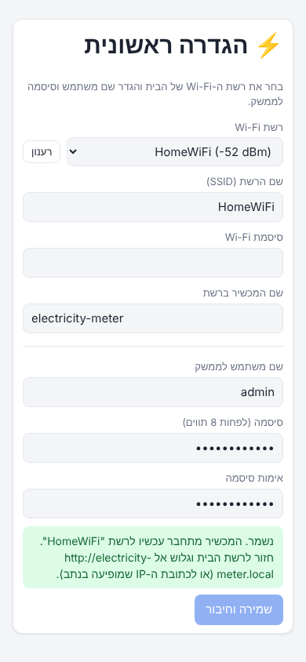
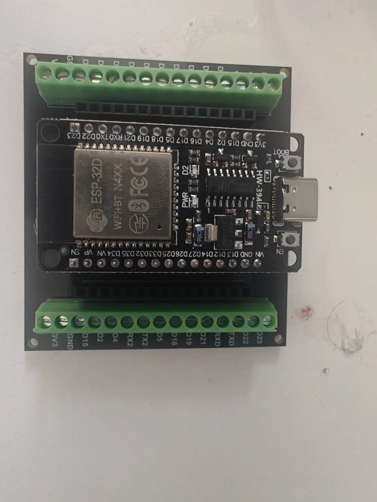
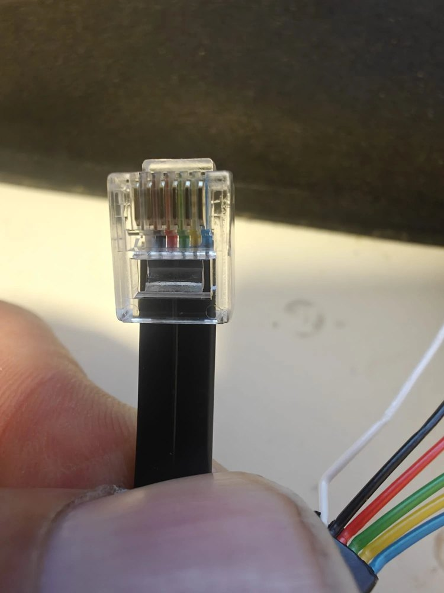
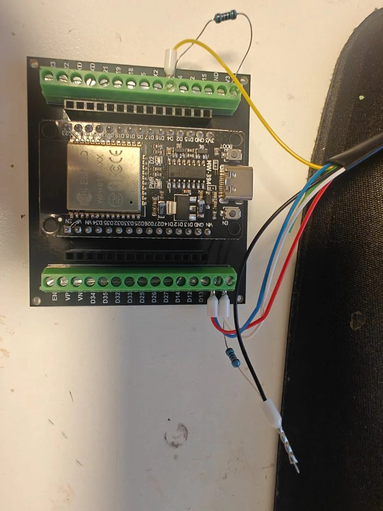
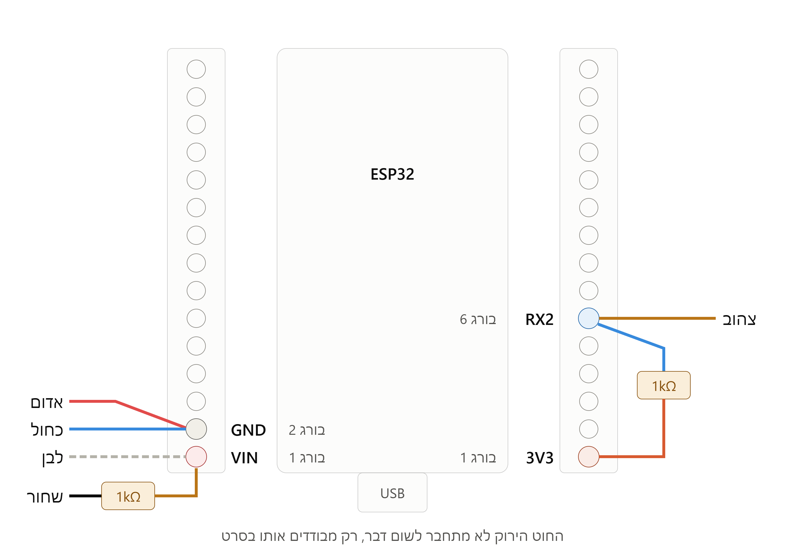
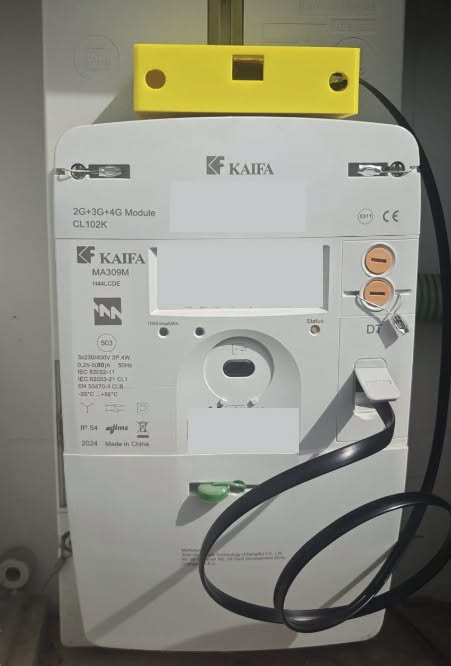
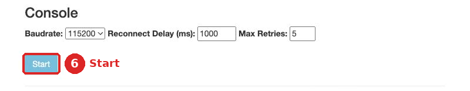

# מדריך: צריבה, בדיקה וחיבור

המדריך עובר על השלבים לפי הסדר. כל שלב נגמר בבדיקה קצרה, כדי שתדע שהכול תקין לפני שממשיכים.

1. [צריבת הקושחה](#1-צריבת-הקושחה)
2. [הגדרה ראשונה](#2-הגדרה-ראשונה)
3. [בדיקה בלי מונה](#3-בדיקה-בלי-מונה)
4. [חיווט וחיבור למונה](#4-חיווט-וחיבור-למונה)
5. [מחיר ומסלול הנחה](#5-מחיר-ומסלול-הנחה)
6. [עדכון קושחה](#6-עדכון-קושחה)
7. [תקלות](#7-תקלות)

---

## 1. צריבת הקושחה

בשלב הזה הלוח מחובר **רק למחשב**. עוד לא למונה.

### חיבור הלוח למחשב

<p align="center"></p>

חבר את הלוח למחשב בכבל USB-C. הכבל צריך להעביר נתונים: כבל של מטען בלבד לא יעבוד.

בדוק שהמחשב מזהה את הלוח. בחר את מערכת ההפעלה שלך:

<details>
<summary><b>Windows</b></summary>

1. לחץ קליק ימני על כפתור התחל, ובחר **מנהל ההתקנים**.
2. פתח את **יציאות (COM ו-LPT)**. אמורה להופיע השורה `USB-SERIAL CH340 (COM3)`. המספר יכול להיות אחר.
3. השורה לא מופיעה, או שיש לידה סימן קריאה צהוב? התקן את [הדרייבר של יצרן השבב](https://www.wch-ic.com/downloads/CH341SER_EXE.html), ואז נתק את הלוח וחבר אותו שוב.

</details>

<details>
<summary><b>macOS</b></summary>

אין צורך בדרייבר. פתח את **Terminal** והרץ:

```bash
ls /dev/cu.*
```

אמורה להופיע שורה בסגנון `/dev/cu.usbserial-1420`.

</details>

<details>
<summary><b>Linux</b></summary>

אין צורך בדרייבר. בטרמינל:

```bash
ls /dev/ttyUSB*
```

אמורה להופיע השורה `/dev/ttyUSB0`.

פעם אחת, תן למשתמש שלך הרשאה ליציאה. אחר כך התנתק מהמערכת והתחבר שוב:

```bash
sudo usermod -aG dialout $USER     # ב-Arch: uucp במקום dialout
```

ב-Ubuntu 22.04 ואילך, אם היציאה מופיעה ונעלמת אחרי שנייה, הסר את החבילה שתופסת אותה:

```bash
sudo apt remove brltty
```

</details>

### צריבה מהדפדפן

לא צריך להתקין כלום. צריך רק Chrome או Edge.

1. הורד את [קובץ הקושחה](https://github.com/yoni03/iec-PlatformIO-3phase/raw/main/release/electricity-meter-full.bin).
2. פתח את [ESP Tool](https://espressif.github.io/esptool-js/), הכלי של יצרנית השבב.
3. לחץ **Connect** ①. בחלון שנפתח, בחר את הלוח ולחץ שוב **Connect**.

   

4. בשדה **Flash Address** ②, מחק את מה שכתוב וכתוב `0x0`.

   > **❗ חשוב:** עם כתובת אחרת הצריבה תסתיים בלי שגיאה, אבל הלוח לא יעלה.

5. לחץ **Choose File** ③ ובחר את הקובץ שהורדת.
6. סמן **Erase all** ④ ולחץ **Program** ⑤. הצריבה לוקחת דקה או שתיים. אל תנתק את הלוח עד שמגיעים ל-100%.

   

7. לחץ על כפתור **EN** בלוח.

**✅ בדיקה:** אחרי כמה שניות מופיעה רשת Wi-Fi בשם `HElectricity`.

<details>
<summary><b>מתקדם: צריבה עם PlatformIO</b></summary>

הדרך הזו מתאימה אם רוצים לבנות את הקוד בעצמך, או לקבוע מראש את רשת הבית.

1. התקן את [VS Code](https://code.visualstudio.com/). בתוכו, בחלון **Extensions**, התקן את התוסף **PlatformIO IDE**.
2. ב-Linux צריך גם את הפקודות האלה, פעם אחת:

   ```bash
   sudo apt install python3-venv        # Debian / Ubuntu
   curl -fsSL https://raw.githubusercontent.com/platformio/platformio-core/develop/platformio/assets/system/99-platformio-udev.rules | sudo tee /etc/udev/rules.d/99-platformio-udev.rules
   sudo udevadm control --reload-rules && sudo udevadm trigger
   ```

3. הורד את הקוד: בדף [הריפו](https://github.com/yoni03/iec-PlatformIO-3phase) לחץ **Code** ואז **Download ZIP**, וחלץ את הקובץ.
4. ב-VS Code, לחץ **File** ואז **Open Folder**, ובחר את התיקייה **`firmware`**. לא את התיקייה הראשית. בראש החלון צריך להופיע `firmware`.
5. לא חובה: כדי לקבוע מראש את רשת הבית, העתק את `src/secrets.example.h` לקובץ חדש בשם `src/secrets.h`, ומלא בו את הפרטים לפי ההוראות שבתוכו. הקובץ לא עולה ל-GitHub.
6. לחץ **Upload** (→) בשורת המצב בתחתית החלון. בפעם הראשונה PlatformIO מוריד כלים, וזה לוקח כמה דקות.

**✅ בדיקה:** בסוף מופיע `[SUCCESS]`. אם קבעת את רשת הבית, דלג על שלב 2.

</details>

---

## 2. הגדרה ראשונה

<p align="center"></p>

1. בטלפון או במחשב, התחבר לרשת `HElectricity`. הסיסמה: `meter1234`.
2. דף ההגדרה נפתח לבד. אם לא, גלוש אל `http://192.168.4.1`.
3. בחר את רשת הבית והזן את הסיסמה שלה. המכשיר עובד רק עם רשת 2.4GHz.
4. בחר שם משתמש וסיסמה לממשק. הסיסמה צריכה לפחות 8 תווים.
5. לחץ **שמירה וחיבור**.
6. חזור לרשת הבית, וגלוש אל **`http://electricity-meter.local`**.

**✅ בדיקה:** מופיע מסך הכניסה לממשק.

הכתובת לא נפתחת? היכנס דרך כתובת ה-IP של המכשיר, מרשימת המכשירים בנתב. מומלץ לקבוע לו בנתב כתובת קבועה.

שכחת את הסיסמה? החזק את כפתור **BOOT** בלוח 10 שניות. המכשיר ישכח את רשת הבית ואת הסיסמה, ותחזור לשלב הזה. אם צרבת עם `secrets.h`, הוא יחזור לפרטים שבקובץ. ההיסטוריה וההגדרות האחרות נשמרות.

---

## 3. בדיקה בלי מונה

מצב הדגמה מדמה מונה תלת-פאזי. כך בודקים את כל המערכת עוד לפני החיווט.

1. בממשק, עבור ל**הגדרות** וסמן **מצב הדגמה**.
2. עבור ל**עכשיו** ובדוק:
   * בכותרת מופיעה נקודה ירוקה.
   * ההספק מתעדכן כל 2 שניות.
   * יש שלושה כרטיסים, אחד לכל פאזה.
3. חכה 5 דקות, ועבור ל**היסטוריה**. הגרף מתחיל להתמלא.
4. ב**הגדרות**, לחץ **הפעלה מחדש**. אחרי דקה, הצריכה של היום וההיסטוריה עדיין שם.
5. בסיום, בטל את **מצב הדגמה**. אחר כך לחץ פעמיים על **מחיקת כל ההיסטוריה**, כדי שהנתונים המדומים לא יתערבבו עם האמיתיים.

**✅ בדיקה:** כל הסעיפים עבדו. אפשר לעבור לחיווט.

---

## 4. חיווט וחיבור למונה

### חיווט

<table>
  <tr>
    <td align="center" width="33%"><br><b>ה-ESP32 על לוח המהדקים</b></td>
    <td align="center" width="33%"><br><b>תקע RJ12 עם 6 גידים</b></td>
    <td align="center" width="33%"><br><b>אחרי החיווט</b></td>
  </tr>
</table>



| פין ב-RJ12 | תפקיד | מתחבר אל |
|---|---|---|
| 1 | מתח 5V+ | `VIN` |
| 2 | בקשת נתונים | נגד 1kΩ, ומשם לפין 1 |
| 3 | אדמה של הנתונים | `GND` |
| 4 | לא בשימוש | לא מחברים |
| 5 | נתונים | `GPIO16` |
| 6 | אדמה של המתח | `GND` |

בנוסף, מחברים נגד 1kΩ שני בין `3V3` ל-`GPIO16`.

**איך מזהים את פין 1:** מחזיקים את התקע כשהלשונית למעלה והמגעים מולך. פין 1 הוא השמאלי. צבעי החוטים משתנים מכבל לכבל, לכן מזהים לפי מיקום ולא לפי צבע.

### חיבור למונה

> **⚠️ זהירות**
>
> * אף פעם לא לחבר את הלוח ל-USB ולמונה באותו זמן.
> * פין 2 מתחבר רק דרך הנגד. אסור לחבר אותו לפין של ה-ESP32.
> * עובדים רק מול שקע ה-P1. לא נוגעים בצד החשמלי של המונה.

1. נתק את הלוח מה-USB. ודא שמצב ההדגמה כבוי.
2. הוצא את ה-ESP32 מלוח המהדקים.
3. חבר את התקע לשקע ה-P1 במונה. מדוד מתח DC בין המהדקים `VIN` ו-`GND`.
   * צריך לראות בערך **5V+**. אפשר להמשיך.
   * רואים **5V-**? החיווט הפוך. אל תמשיך עד שתתקן.
4. נתק את התקע, החזר את ה-ESP32 ללוח המהדקים, וחבר שוב את התקע.

**✅ בדיקה, אחרי דקה:**

* הנורית הכחולה בלוח מהבהבת פעם בשנייה.
* ב**עכשיו**, ההספק מתאים למה שדולק בבית. הדלקת קומקום מעלה אותו בכ-2kW.
* בתחתית **עכשיו**, הערך "מונה צריכה" זהה למספר שבתצוגת המונה.

<p align="center"></p>

---

## 5. מחיר ומסלול הנחה

ב**הגדרות**, תחת **מחיר ומסלול**:

* **מחיר לקוט"ש:** כולל מע"מ. ברירת המחדל היא 0.6352 ₪, התעריף של חברת החשמל מ-1 ביולי 2026.
* **תשלום קבוע לחודש:** אם יש. הוא נכנס רק לצפי של סוף התקופה.
* **יום תחילת החיוב:** היום בחודש שבו מתחיל החשבון אצל ספק החשמל.
* **חיבור לכל פאזה:** לפי המפסק הראשי, למשל 25 או 40 אמפר.

**הנחות לפי שעות:** אפשר להגדיר עד 4 כללים. לכל כלל יש אחוז הנחה, שעות וימים. אם כמה כללים חלים על אותה שעה, חלה ההנחה הגבוהה. הכפתורים תחת **תבניות** מוסיפים כלל מוכן, ונשאר רק לעדכן את האחוז.

| מסלול | משעה | עד שעה | ימים |
|---|---|---|---|
| הנחה בכל השעות | 00:00 | 24:00 | כל הימים |
| הנחת לילה | 23:00 | 07:00 | כל הימים |
| הנחת יום | 07:00 | 17:00 | א׳–ה׳ |

שינוי מחיר חל מרגע השמירה. העלות של צריכה שכבר נשמרה לא משתנה.

---

## 6. עדכון קושחה

אחרי שהמכשיר מותקן ליד המונה, מעדכנים אותו מהדפדפן, בלי USB.

1. הורד את [קובץ העדכון](https://github.com/yoni03/iec-PlatformIO-3phase/raw/main/release/electricity-meter-ota.bin). אם בנית בעצמך, הקובץ נמצא ב-`firmware/.pio/build/esp32dev/firmware.bin`.
2. בממשק, עבור ל**הגדרות** ואז **עדכון קושחה**. בחר את הקובץ ולחץ **עדכון**.

**✅ בדיקה:** אחרי חצי דקה המכשיר עולה מחדש. ההיסטוריה וההגדרות נשמרות.

אם העדכון נכשל באמצע, המכשיר ממשיך לעבוד עם הגרסה הקודמת.

---

## 7. תקלות

### בצריבה

| תקלה | מה לעשות |
|---|---|
| הלוח לא מופיע ברשימת היציאות | נסה כבל אחר, וחבר ישירות למחשב. בדוק לפי מערכת ההפעלה, בשלב 1. ב-Ubuntu, השתמש ב-Google Chrome ולא ב-Chromium |
| החיבור נתקע ב-`Connecting...` | החזק את כפתור **BOOT**, לחץ שוב **Connect**, ושחרר כשהכתיבה מתחילה |
| הצריבה נכשלת באמצע | לחץ **Disconnect**, שנה את **Baudrate** ל-`115200`, ונסה שוב |
| הודעה שהיציאה תפוסה (`port is busy`) | סגור תוכנה אחרת שמשתמשת בלוח, ונסה שוב |
| הצריבה הסתיימה, אבל `HElectricity` לא מופיעה | צרוב שוב. ודא שכתבת `0x0` בשדה **Flash Address** וסימנת **Erase all** |
| ב-VS Code אין כפתור Upload, או שמופיעה שגיאת `#include` | פתח את התיקייה `firmware`, לא את התיקייה הראשית. חכה שההורדות בפינה הימנית התחתונה יסתיימו |

### בשימוש

| תקלה | מה לעשות |
|---|---|
| המכשיר לא מתחבר לרשת הבית | בדוק שהרשת היא 2.4GHz ושהסיסמה נכונה. אחרי 3 דקות בלי חיבור נפתחת שוב הרשת `HElectricity`, ואפשר לתקן דרכה |
| הכתובת `electricity-meter.local` לא נפתחת | היכנס דרך כתובת ה-IP של המכשיר, מרשימת המכשירים בנתב |
| הודעה "אין נתונים מהמונה" | בדוק את החיווט: המתח ב-`VIN`, החיבור ל-`GPIO16`, הנגד של פין 2, ושהתקע נכנס עד הסוף |
| שגיאות CRC רבות, ב**הגדרות** | בדוק את הנגד בין `3V3` ל-`GPIO16`, חוטים רופפים, ואת חיבורי ה-`GND` |
| הודעה "השעון לא מסונכרן" | אין אינטרנט. אחרי דקה וחצי המכשיר לוקח את השעה מהמונה |
| המכשיר נכבה ונדלק שוב ושוב | ייתכן שהמונה לא מספק מספיק זרם. נסה לוח ESP32 אחר |
| ההשוואה לאתמול לא מופיעה | היא מופיעה אחרי יממה מלאה של נתונים |

<details>
<summary><b>איך רואים את הלוג של המכשיר</b></summary>

הלוג עוזר להבין מה קורה בלוח. חבר את הלוח ב-USB, בלי המונה.

1. פתח את [ESP Tool](https://espressif.github.io/esptool-js/).
2. באזור **Console**, לחץ **Start** ⑥ ובחר את הלוח.
3. לחץ על כפתור **EN** בלוח.



כשהכול תקין, הלוג נראה בערך כך:

```
Electricity meter 1.0.0
[fs] … / 1441792 bytes used
[wifi] not configured: starting the setup access point
[wifi] access point 'HElectricity' on, http://192.168.4.1
[web] server on port 80
```

</details>
